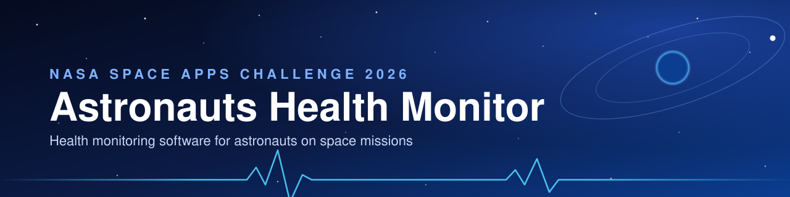
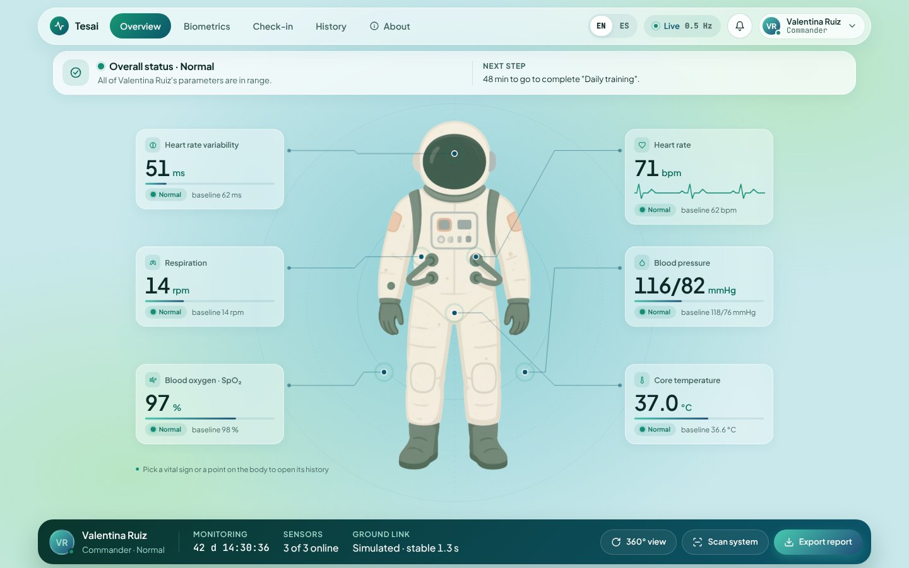
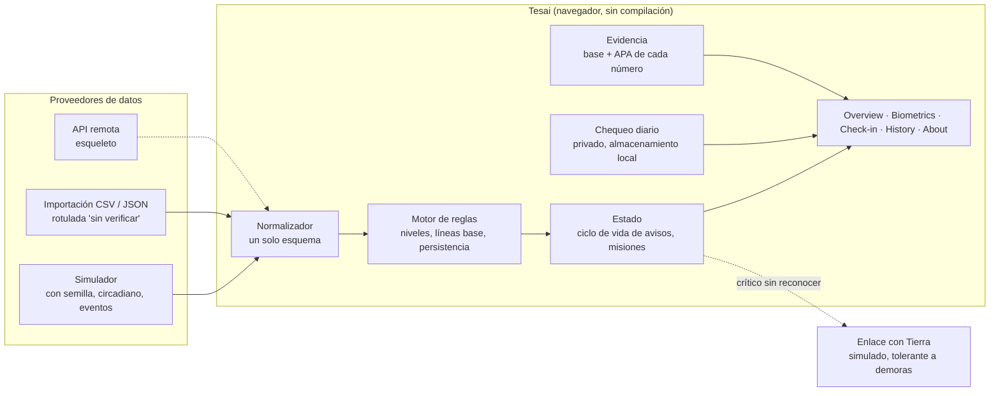
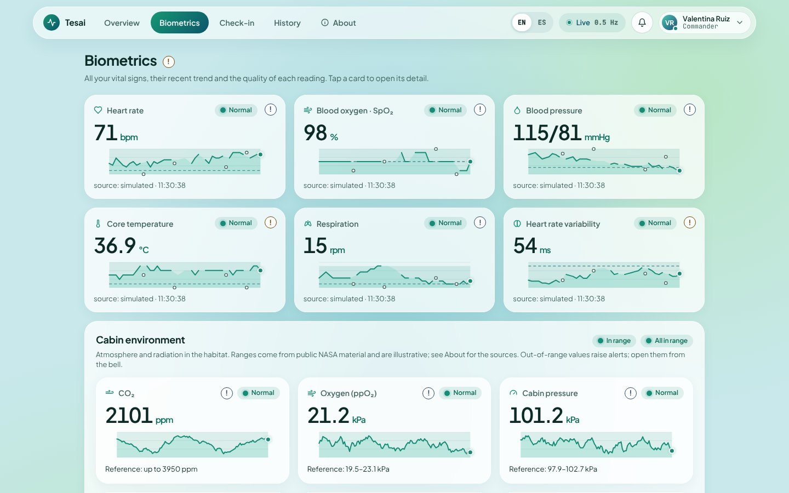
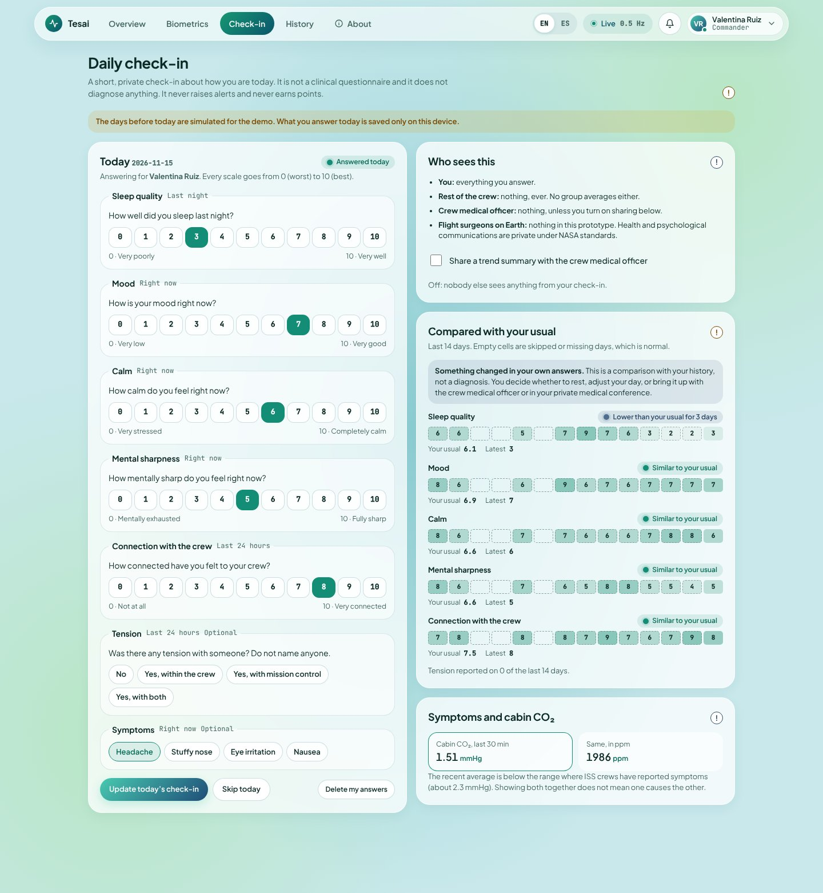

<p align="center">
  
</p>

<div align="center">

# Tesai

**Un gemelo de salud para tripulaciones espaciales que dice cuánto confiar en cada número.**

NASA Space Apps Challenge 2026 · *Create Health Monitoring Software for Astronauts on Space Missions*<br>
Equipo Higía · Buenos Aires, Argentina

<a href="https://www.spaceappschallenge.org/2026/challenges/health-monitoring-software/"></a>


**Español** · [English](#english)

</div>



## Contenido

1. [El problema](#el-problema)
2. [Nuestra solución](#nuestra-solución)
3. [Cómo se arma](#cómo-se-arma)
4. [La app, pantalla por pantalla](#la-app-pantalla-por-pantalla)
5. [Cada número muestra su base](#cada-número-muestra-su-base)
6. [Factores humanos y privacidad](#factores-humanos-y-privacidad)
7. [Cómo correrla](#cómo-correrla) · [Probala](#probala)
8. [Tecnología](#tecnología) · [Estructura del proyecto](#estructura-del-proyecto)
9. [Uso de IA](#uso-de-ia) · [Datos de la NASA](#datos-de-la-nasa) · [Límites](#límites) · [Equipo](#equipo) · [Aviso](#aviso)

## El problema

El Programa de Investigación Humana de la NASA agrupa los riesgos de las misiones largas en cinco peligros: radiación espacial, aislamiento y confinamiento, distancia de la Tierra, gravedad alterada y ambientes hostiles y cerrados. Pueden traer pérdida ósea y muscular, cambios cardiovasculares, mal sueño y problemas de salud conductual.

Camino a Marte, un mensaje a la Tierra puede tardar hasta unos 20 minutos por tramo. La tripulación tiene que notar los cambios en sí misma y decidir qué hacer, muchas veces sin un médico en tiempo real. Eso plantea dos preguntas que la mayoría de los tableros de salud pasan por alto:

- **¿Cuánto confío en este número?** Un límite puede salir de un estándar de la NASA, de un rango clínico terrestre nunca validado en vuelo o de un valor elegido para una demo. En pantalla, todos se ven iguales.
- **¿Voy a responder con honestidad?** Los astronautas tienen motivos documentados para subreportar síntomas, porque los datos de salud pueden afectar su asignación a vuelos futuros (Institute of Medicine, 2001). Un monitor que lo ignora mide prudencia, no salud.

## Nuestra solución

Tesai muestra en pocas pantallas los signos vitales, el sueño, la actividad y el ambiente de cabina de cada tripulante, más un chequeo diario privado, y es honesto con cada número.

| | |
|---|---|
| 🧍 **Gemelo de salud** | Una figura del cuerpo con seis signos vitales, cada uno comparado con la línea base de la propia persona y con un rango de referencia |
| 🌬️ **Ambiente de cabina** | CO₂, oxígeno, presión, temperatura, humedad y radiación, con rangos de NASA-STD-3001 |
| 📝 **Chequeo diario privado** | Cinco escalas de 0 a 10 (calidad del sueño, ánimo, calma, lucidez mental y conexión con la tripulación). Queda en el dispositivo, nunca genera avisos, nunca da puntos y se compara solo con la propia historia |
| 🔔 **Avisos sin falsas alarmas** | Un aviso por condición, persistencia antes de avisar, lecturas con ruido ignoradas, fallas de sensor aparte y "Datos parciales" en lugar de "Normal" |
| ❗ **Evidencia en cada número** | Un botón "!" junto a cada límite, meta y regla: si sale de una fuente, si es una adaptación o si es un valor de diseño del equipo, con referencias APA |
| 📡 **Enlace con Tierra tolerante a demoras** | Los avisos críticos que nadie reconoce se escalan por un enlace simulado con la Tierra |

> **Estado (15 de noviembre de 2026):** todas las pantallas funcionan en el navegador con datos simulados. Tesai es un prototipo de hackathon, **no un dispositivo médico**. Los umbrales son ilustrativos. El escenario de la demo es similar al de la ISS.

## Cómo se arma



El motor de reglas no sabe de dónde vienen los datos, y el chequeo diario nunca lo alimenta.

## La app, pantalla por pantalla

La interfaz tiene un botón **EN | ES** para cambiar de idioma.

### Overview (vista general)
El gemelo de salud con seis signos vitales, el estado general y un próximo paso sugerido, las misiones diarias y una vista compacta de la cabina. Al tocar un signo vital se abre su historial reciente al lado del cuerpo.

### Biometrics (biometría)
Una tarjeta por signo vital con su tendencia y la calidad de la lectura, seis métricas de cabina con sus rangos de referencia, y sueño y actividad. Cada tarjeta tiene su botón "!".



### Check-in (chequeo diario)
Un chequeo breve sobre cómo estás hoy. Todas las escalas van de 0 (peor) a 10 (mejor), con los extremos rotulados y el período aclarado. La tensión (sin nombres; con la tripulación o con el control de misión) y los síntomas son opcionales. Antes de responder se ve el panel "Quién ve esto". Los últimos 14 días se comparan con lo habitual en la propia persona. Si se reporta dolor de cabeza o nariz tapada, al lado aparece el CO₂ reciente de la cabina, convertido a mmHg, sin afirmar que uno cause el otro.



### Alertas, History y About
Los avisos se abren desde la campana, con ciclo de vida (activo, reconocido, pospuesto, resuelto), prioridades y el enlace simulado con la Tierra. History muestra cada signo vital con sus bandas de estado y su línea base, la calidad de la señal, las misiones y la racha. About lista la evidencia por dato, la procedencia de los datos y todas las referencias.

## Cada número muestra su base

| Base | Qué significa | Ejemplo |
|---|---|---|
| Sale de una fuente | El valor sigue uno publicado | Zonas de temperatura de cabina (NASA-STD-3001 Vol. 2) |
| Adaptado de una fuente | Parte de una fuente, y la nota dice qué cambió | CO₂: 3 mmHg como promedio de 1 hora, evaluado por lectura y mostrado en ppm |
| Valor de diseño del equipo | No se encontró una fuente publicada | Límites de temperatura central, la regla del 25 % sobre la línea base, la regla de comparación del chequeo |
| Sin fuente de datos real | Simulado | Todas las lecturas de la demo |


La investigación detrás de estas etiquetas está resumida en [`docs/research-summary.md`](docs/research-summary.md) (en inglés).

## Probala

1. Todos los datos son simulados (semilla 2026).
2. **Overview:** tocá un signo vital del gemelo para ver su historial.
3. **Biometrics:** apretá cualquier "!" para ver de dónde sale un límite.
4. **Check-in:** respondé las cinco escalas y guardá. Después mirá "Compared with your usual". La historia simulada de Valentina Ruiz muestra una caída de la calidad del sueño en los últimos días.
5. **Inyectá un evento:** abrí `#/advanced`, activá el modo demo e inyectá `co2` o `tachycardia`. El aviso se abre después de varias lecturas, y uno crítico se escala al enlace simulado con la Tierra.
6. Cambiá **EN | ES** en la barra superior.

## Tecnología

HTML, CSS (tokens de diseño, `color-mix`), JavaScript con ES modules y gráficos SVG. Sin framework, sin bundler y sin dependencias. Tipografías Plus Jakarta Sans y JetBrains Mono (SIL OFL).

## Estructura del proyecto

```text
.
├── src/                 La app (ver src/README.md y ARCHITECTURE.md)
│   ├── index.html
│   ├── styles/          tokens → base → layout → components
│   └── js/              config, reglas, estado, chequeo, evidencia, i18n, proveedores, ui
├── docs/                Resumen de la investigación, fundamento de factores humanos, uso de IA
├── data/                Datos y fuentes
├── assets/              Banner e insignias
└── ARCHITECTURE.md      Mapa de módulos, flujo de datos y sistema de avisos
```

## Uso de IA

Hecho con Claude (Anthropic): Claude Design para el diseño visual, Claude Code para la implementación, la revisión y las pruebas, y Claude para resumir la investigación y redactar la documentación. **Dentro de la app no corre ninguna IA.** El equipo decidió qué construir, dirigió el trabajo y tomó las decisiones de producto. Detalle en [`docs/AI_USE.md`](docs/AI_USE.md) y en la pantalla About.

## Datos de la NASA

Tesai no ingiere ningún dataset de la NASA en vivo: no existe un dataset público con signos vitales diarios de astronautas en vuelo. Usa recursos de la NASA como base de sus límites y de su diseño:

- **NASA-STD-3001** Vol. 1 (límite de carrera de 600 mSv, límite de diseño de 1,3 mSv/día por rayos cósmicos galácticos, privacidad médica) y Vol. 2 (CO₂, temperatura y humedad).
- **Informes técnicos de OCHMO** sobre CO₂, ECLSS y atmósfera habitable.
- Páginas de riesgos y peligros del **Programa de Investigación Humana**, y ARCHeR.
- **Informes de NTRS**: CO₂ en la ISS, concepto de operaciones de apoyo a la decisión clínica, operaciones médicas independientes de la Tierra, CHP-IDSP.
- **Agencia Espacial Canadiense**: monitoreo de radiación y Bio-Monitor.

Lista completa con condiciones de uso: [`data/README.md`](data/README.md).

## Límites

- Tesai **no diagnostica** ni reemplaza a un profesional de la salud.
- Todas las lecturas son simuladas. La historia del chequeo anterior a hoy es simulada y está rotulada.
- Los umbrales son ilustrativos y no tienen validación clínica. Los rangos de signos vitales salen de referencias terrestres.
- El CO₂ se evalúa por lectura, no como el promedio de 1 hora que usa el estándar.
- La línea roja de radiación sale de un límite de diseño diario y marcaría todo un tránsito a Marte. Una versión para Marte debería seguir la dosis acumulada contra los 600 mSv.
- Las preguntas del chequeo son originales y no son un instrumento validado.
- No se transmite nada: el enlace con la Tierra y la opción de compartir el chequeo son simulaciones.

## Equipo

**Equipo Higía:** Ezequiel Alfaro, Sebastian Garay, Nataya Flores, Mateo Capararo.

## Aviso

Proyecto independiente realizado en el marco del NASA Space Apps Challenge. No está afiliado a la NASA ni cuenta con su aval. La NASA no respalda a entidades que no pertenezcan al gobierno de EE. UU. Este repositorio no usa logos, banderas ni identificadores de misión de la NASA.

---

<a id="english"></a>

# Tesai (English)

**A health twin for space crews that tells you how much to trust each number.**

NASA Space Apps Challenge 2026 · *Create Health Monitoring Software for Astronauts on Space Missions* · Team Higía · Buenos Aires, Argentina

## The problem

NASA's Human Research Program groups the risks of long missions into five hazards: space radiation, isolation and confinement, distance from Earth, altered gravity, and hostile, closed environments. They can bring bone and muscle loss, cardiovascular changes, poor sleep and behavioral health problems.

On the way to Mars, a message to Earth can take up to about 20 minutes each way. The crew has to notice changes in themselves and decide what to do, often without a doctor in real time. That raises two questions most health dashboards skip:

- **How much should I trust this number?** A limit can come from a NASA standard, from an Earth clinical range never validated in flight, or from a value picked for a demo. On screen they all look the same.
- **Will I answer honestly?** Astronauts have documented reasons to under-report symptoms, because health data can affect future flight assignments (Institute of Medicine, 2001). A monitor that ignores that measures caution, not health.

## Our solution

Tesai shows one crew member's vital signs, sleep, activity, cabin environment and a private daily check-in on a few screens, and is honest about every number.

- **Health twin:** a body figure with six vital signs, each compared with the person's own baseline as well as a reference range.
- **Cabin environment:** CO₂, oxygen, pressure, temperature, humidity and radiation, with ranges from NASA-STD-3001.
- **Private daily check-in:** five 0–10 scales (sleep quality, mood, calm, mental sharpness, connection with the crew). It stays on the device, never raises alerts, never earns points, and is compared only with the person's own history.
- **Alerts that do not cry wolf:** one alert per condition, persistence before raising, noisy readings ignored, sensor problems kept apart, "Partial data" instead of "Normal".
- **Evidence on every number:** a "!" button next to every limit, goal and rule (based on a source, adapted, or a team design value), with APA references.
- **Delay-tolerant ground link:** critical alerts that nobody acknowledges are escalated through a simulated link to Earth.

> **Status (15 Nov 2026):** all screens work in the browser with simulated data. Tesai is a hackathon prototype, **not a medical device**. Thresholds are illustrative. The demo scenario is ISS-like.

## Every number shows its basis

| Basis | Meaning | Example |
|---|---|---|
| Based on a source | The value follows a published one | Cabin temperature zones (NASA-STD-3001 Vol. 2) |
| Adapted from a source | Starts from a source, and the note says what changed | CO₂: 3 mmHg 1-hour average, checked per reading and shown in ppm |
| Team design value | No published source was found | Core temperature limits, the 25 % baseline rule, the check-in comparison rule |
| No real data source | Simulated | Every reading in the demo |

Research summary: [`docs/research-summary.md`](docs/research-summary.md).

## Tech stack

HTML, CSS (design tokens, `color-mix`), JavaScript ES modules, SVG charts. No framework, no bundler, no dependencies. Plus Jakarta Sans and JetBrains Mono (SIL OFL).

## Use of AI

Built with Claude (Anthropic): Claude Design for the visual design, Claude Code for implementation, review and testing, and Claude for research summaries and documentation. **No AI runs inside the app.** The team chose what to build, directed the work and made the product decisions. Details: [`docs/AI_USE.md`](docs/AI_USE.md).

## NASA data used

Tesai does not ingest a live NASA dataset: no public dataset of daily in-flight astronaut vital signs exists. It uses NASA resources as the basis for its limits and design: NASA-STD-3001 Vol. 1 and Vol. 2, OCHMO technical briefs, Human Research Program risk and hazard pages, ARCHeR, and NTRS reports (CO₂ on the ISS, clinical decision support, Earth-independent medical operations, CHP-IDSP), plus Canadian Space Agency material on radiation and the Bio-Monitor. Full list: [`data/README.md`](data/README.md).

## Limits

- Tesai **does not diagnose** and does not replace a healthcare professional.
- All readings are simulated. The check-in history before today is simulated and labeled.
- Thresholds are illustrative and have no clinical validation. Vital-sign ranges come from Earth references.
- CO₂ is checked per reading, not as the 1-hour average the standard uses.
- The radiation red line comes from a daily design limit and would flag a whole Mars transit. A Mars version should track cumulative dose against 600 mSv.
- The check-in questions are original and not a validated instrument.
- Nothing is transmitted: the ground link and check-in sharing are simulations.

## Team

**Team Higía:** Ezequiel Alfaro, Sebastian Garay, Nataya Flores, Mateo Capararo.

## Disclaimer

An independent project made for the NASA Space Apps Challenge. It is not affiliated with or endorsed by NASA. NASA does not endorse non-U.S. Government entities. This repository does not use NASA logos, flags or mission identifiers.
