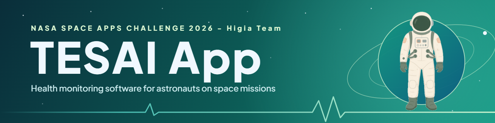
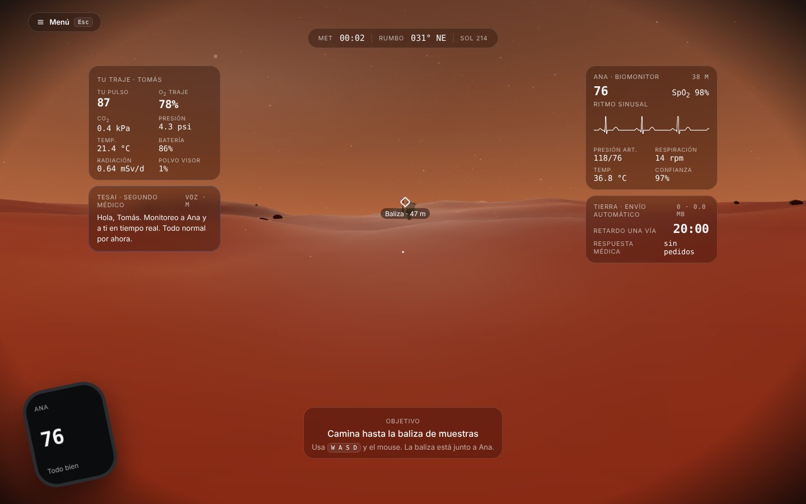
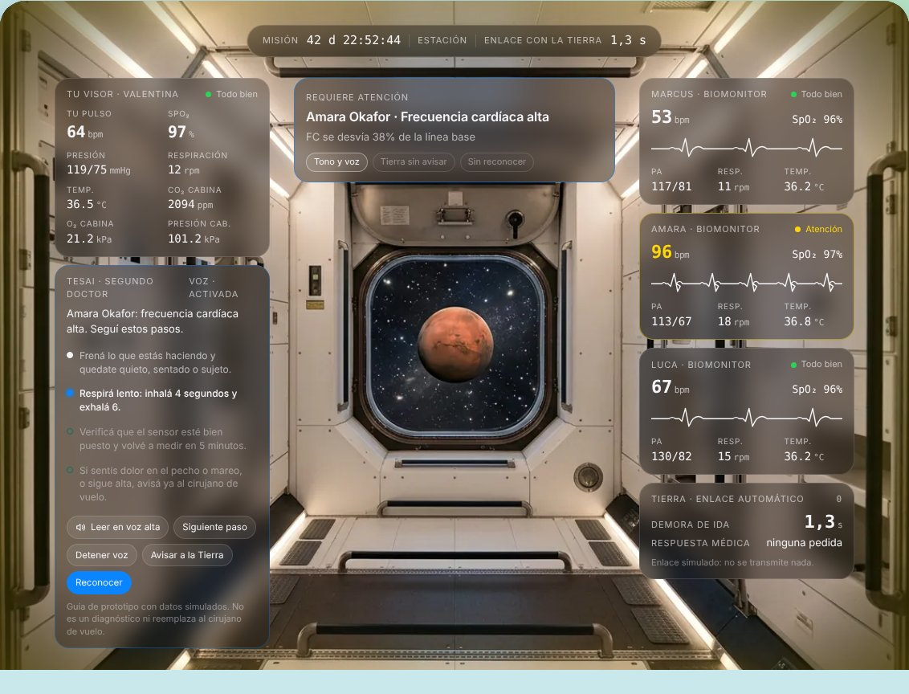
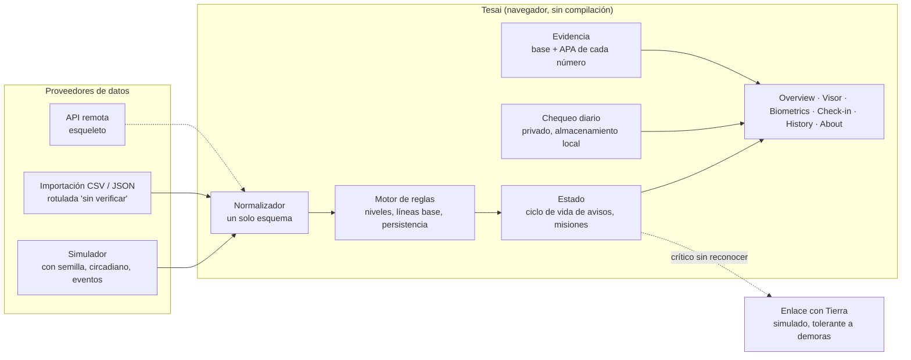
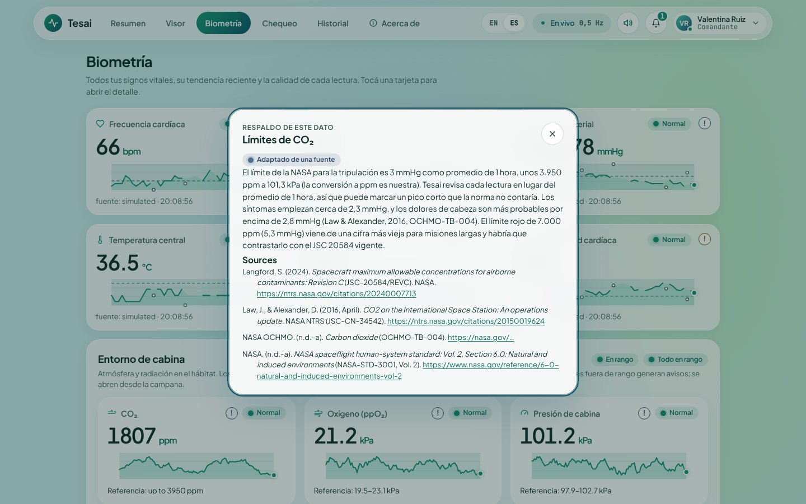

<p align="center">
  
</p>

<div align="center">

# Tesai

**Un gemelo de salud para tripulaciones espaciales que dice cuánto confiar en cada número.**

NASA Space Apps Challenge 2026 · *Create Health Monitoring Software for Astronauts on Space Missions*<br>
Equipo Higía · Buenos Aires, Argentina

<a href="https://www.spaceappschallenge.org/2026/challenges/health-monitoring-software/"></a>


**Español** · [English](#english)

</div>



## Contenido

1. [El problema](#el-problema)
2. [Nuestra solución](#nuestra-solución)
3. [La simulación](#la-simulación)
4. [El Visor y el segundo doctor](#el-visor-y-el-segundo-doctor)
5. [Cómo se arma](#cómo-se-arma)
6. [La app, pantalla por pantalla](#la-app-pantalla-por-pantalla)
7. [Cada número muestra su base](#cada-número-muestra-su-base)
8. [Seguridad y privacidad](#seguridad-y-privacidad) · [Tecnología](#tecnología) · [Estructura del proyecto](#estructura-del-proyecto)
9. [Uso de IA](#uso-de-ia) · [Datos de la NASA](#datos-de-la-nasa) · [Límites](#límites) · [Equipo](#equipo) · [Licencia](#licencia) · [Aviso](#aviso)

## El problema

El Programa de Investigación Humana de la NASA agrupa los riesgos de las misiones largas en cinco peligros: radiación espacial, aislamiento y confinamiento, distancia de la Tierra, gravedad alterada y ambientes hostiles y cerrados. Pueden traer pérdida ósea y muscular, cambios cardiovasculares, mal sueño y problemas de salud conductual.

Camino a Marte, un mensaje a la Tierra puede tardar hasta unos 20 minutos por tramo. La tripulación tiene que notar los cambios en sí misma y decidir qué hacer, muchas veces sin un médico en tiempo real. Eso plantea dos preguntas que la mayoría de los tableros de salud pasan por alto:

- **¿Cuánto confío en este número?** Un límite puede salir de un estándar de la NASA, de un rango clínico terrestre nunca validado en vuelo o de un valor elegido para una demo. En pantalla, todos se ven iguales.
- **¿Voy a responder con honestidad?** Los astronautas tienen motivos documentados para subreportar síntomas, porque los datos de salud pueden afectar su asignación a vuelos futuros (Institute of Medicine, 2001). Un monitor que lo ignora mide prudencia, no salud.

## Nuestra solución

Tesai es un segundo médico dentro del visor. Muestra los signos vitales de toda la tripulación, el sueño, la actividad y el ambiente de cabina, guía paso a paso cuando algo cambia y es honesto con cada número. Se puede vivir en una simulación en primera persona y explorar en un prototipo completo.

| | |
|---|---|
| 🎮 **Simulación inmersiva** | Tres emergencias en primera persona (caminata en Marte, rover presurizado y nave en tránsito) en las que sos el primer médico y Tesai te guía por voz |
| 🧍 **Gemelo de salud** | Una figura del cuerpo con seis signos vitales, cada uno comparado con la línea base de la propia persona y con un rango de referencia |
| 🌬️ **Ambiente de cabina** | CO₂, oxígeno, presión, temperatura, humedad y radiación, con rangos de NASA-STD-3001 |
| 📝 **Chequeo diario privado** | Cinco escalas de 0 a 10 (calidad del sueño, ánimo, calma, lucidez mental y conexión con la tripulación). Queda en el dispositivo, nunca genera avisos, nunca da puntos y se compara solo con la propia historia |
| 🔔 **Avisos sin falsas alarmas** | Un aviso por condición, persistencia antes de avisar, lecturas con ruido ignoradas, fallas de sensor aparte y "Datos parciales" en lugar de "Normal" |
| 🪖 **Visor y segundo doctor** | Vista en primera persona a través del visor del casco, con los signos vitales de la tripulación proyectados y una guía paso a paso para cada aviso |
| 🔊 **Audio incorporado** | Un tono al abrirse un aviso y, en los críticos, una voz que lee la situación en español o en inglés |
| ❗ **Evidencia en cada número** | Un botón "!" junto a cada límite, meta y regla: si sale de una fuente, si es una adaptación o si es un valor de diseño del equipo, con referencias APA |
| 📡 **Enlace con Tierra tolerante a demoras** | Los avisos críticos que nadie reconoce se escalan por un enlace simulado con la Tierra |

> **Estado (15 de noviembre de 2026):** todas las pantallas funcionan en el navegador con datos simulados. Tesai es un prototipo de hackathon, **no un dispositivo médico**. Los umbrales son ilustrativos. El escenario de la demo es similar al de la ISS.

## La simulación

Es la puerta de entrada: corre en el navegador, sin instalar nada. Elegís un escenario y un compañero colapsa. Vos sos el primer médico, porque la Tierra tarda hasta 20 minutos en enterarse.

| Escenario | Qué pasa | Qué tenés que hacer |
|---|---|---|
| **EVA en Marte** | Ana colapsa en plena caminata y el regolito tapa el visor | Llegar al DEA del rover; con el traje puesto no hay RCP posible |
| **Rover presurizado** | Luis se desploma al volante | Tesai detiene el rover y avisa a todos; DEA y RCP guiada dentro de la cabina |
| **Nave en tránsito** | Día 96 rumbo a Marte, Mei pierde el conocimiento en microgravedad | Fijarla a la camilla antes de reanimarla |

En el visor del casco ves tus propios datos y el biomonitor de la persona afectada. El segundo doctor te dice qué hacer y te marca el ritmo de la RCP por voz, mientras el aviso a la Tierra sale solo, con su demora. Al final, un resumen muestra cuánto tardaste, la calidad de la RCP y qué dispositivos se alertaron. Se juega con WASD, el mouse y la tecla E.

## El Visor y el segundo doctor

El Visor lleva lo mismo que se ve en la simulación al prototipo: la vista a través del casco, con los signos vitales de toda la tripulación proyectados en el vidrio.



- **Tu visor:** tu pulso, SpO₂, presión, respiración y temperatura, más el CO₂, el oxígeno y la presión de la cabina.
- **Biomonitores:** el resto de la tripulación, cada uno con su ECG y su estado. El estado siempre va con palabra además de color.
- **Aviso de situación:** cuando algo cambia, aparece en el centro con quién y qué, y suena un tono. En los críticos, una voz lee la situación.
- **Segundo doctor:** una guía paso a paso para ese aviso. Se puede leer en voz alta, avanzar, avisar a la Tierra y reconocer.
- **Enlace con la Tierra:** la demora de ida y si ya salió el aviso. Es simulado: no se transmite nada.
- **Probá una situación:** debajo del visor, un panel dispara un evento simulado (taquicardia, oxígeno bajo, fiebre, presión alta o CO₂ alto) para cualquier tripulante.

## Cómo se arma



El motor de reglas no sabe de dónde vienen los datos, y el chequeo diario nunca lo alimenta.

## La app, pantalla por pantalla

La interfaz tiene un botón **EN | ES** para cambiar de idioma, el mismo en la web, la simulación y el prototipo.

### Overview (vista general)
El gemelo de salud con seis signos vitales, el estado general y un próximo paso sugerido, las misiones diarias y una vista compacta de la cabina. Al tocar un signo vital se abre su historial reciente al lado del cuerpo.


### Biometrics (biometría)
Una tarjeta por signo vital con su tendencia y la calidad de la lectura, seis métricas de cabina con sus rangos de referencia, sueño y actividad, y los dispositivos que toman las lecturas, que se pueden separar en piezas. Cada tarjeta tiene su botón "!".


### Check-in (chequeo diario)
Un chequeo breve sobre cómo estás hoy. Todas las escalas van de 0 (peor) a 10 (mejor), con los extremos rotulados y el período aclarado. La tensión (sin nombres; con la tripulación o con el control de misión) y los síntomas son opcionales. Antes de responder se ve el panel "Quién ve esto". Los últimos 14 días se comparan con lo habitual en la propia persona. Si se reporta dolor de cabeza o nariz tapada, al lado aparece el CO₂ reciente de la cabina, convertido a mmHg, sin afirmar que uno cause el otro.


### Alertas, History y About
Los avisos se abren desde la campana, con ciclo de vida (activo, reconocido, pospuesto, resuelto), prioridades y el enlace simulado con la Tierra. History muestra cada signo vital con sus bandas de estado y su línea base, la calidad de la señal, las misiones y la racha. About lista la evidencia por dato, cada una con sus referencias, y la procedencia de los datos.

## Cada número muestra su base

| Base | Qué significa | Ejemplo |
|---|---|---|
| Sale de una fuente | El valor sigue uno publicado | Zonas de temperatura de cabina (NASA-STD-3001 Vol. 2) |
| Adaptado de una fuente | Parte de una fuente, y la nota dice qué cambió | CO₂: 3 mmHg como promedio de 1 hora, evaluado por lectura y mostrado en ppm |
| Valor de diseño del equipo | No se encontró una fuente publicada | Límites de temperatura central, la regla del 25 % sobre la línea base, la regla de comparación del chequeo |
| Sin fuente de datos real | Simulado | Todas las lecturas de la demo |



La investigación detrás de estas etiquetas está resumida en [`docs/research-summary.md`](docs/research-summary.md) (en inglés).

## Seguridad y privacidad

- **Nada sale del navegador.** No hay servidor, cuentas ni base de datos. El enlace con la Tierra y la opción de compartir el chequeo son simulaciones.
- **El chequeo diario queda en el dispositivo** (`localStorage`), sin promedios grupales ni avisos.
- **Sin código inline:** ninguna página tiene `<script>` inline, así que `vercel.json` aplica una Content Security Policy con `script-src 'self'`, más `nosniff`, `X-Frame-Options`, `Referrer-Policy`, `Permissions-Policy` y HSTS.
- **Archivos importados como no confiables:** el CSV o JSON que se carga en `#/advanced` pasa por un normalizador que limpia los ids, acota los textos y descarta métricas desconocidas antes de mostrarse.
- **Sin claves en el cliente:** una fuente de datos real iría detrás de un proxy del lado del servidor que guarde las claves; el navegador solo conoce su dirección.

## Tecnología

HTML, CSS (tokens de diseño, `color-mix`), JavaScript con ES modules y gráficos SVG. Sin framework, sin bundler y sin npm. La simulación usa three.js 0.170.0 (MIT), incluido en el repo. Voz con la Web Speech API y tonos con Web Audio. Tipografías Plus Jakarta Sans y JetBrains Mono (SIL OFL), servidas localmente.

## Estructura del proyecto

```text
.
├── src/                 El sitio de Tesai, lo único que se publica (ver src/README.md)
│   ├── index.html       Web central: el problema, la app, cómo funciona, sensores, accesos y equipo
│   ├── shared/          Colores, tipografías, botones, idioma y barra superior comunes a las tres páginas
│   ├── assets/          Imágenes, logo, tipografías y las capturas y el video del Visor
│   ├── simulacion/      Simulación inmersiva: index.html, styles.css, js/ (textos, escena 3D, bucle) y vendor/three.js
│   └── tesai/           La app Tesai (ver src/tesai/README.md y ARCHITECTURE.md)
│       ├── index.html
│       ├── styles/      base → layout → components → responsive
│       └── js/          config, reglas, estado, chequeo, gemelo, Visor, audio, evidencia, i18n, proveedores, ui
├── tools/twin/          Generador del dibujo del gemelo (escribe src/tesai/js/twin/art.js)
├── react/astronaut/     El gemelo como componentes React, en paralelo a la versión del sitio
├── docs/                Resumen de la investigación, fundamento de factores humanos, uso de IA y capturas
├── data/                Datos y fuentes
├── assets/              Banner e insignias del README
├── vercel.json          Publicación de src/, caché y cabeceras de seguridad
└── ARCHITECTURE.md      Mapa de módulos, flujo de datos, sistema de avisos y despliegue
```


## Uso de IA

Hecho con Claude (Anthropic): Claude Design para el diseño visual, Claude Code para la implementación, la revisión y las pruebas, y Claude para resumir la investigación y redactar la documentación. También se usaron ChatGPT (OpenAI) y Gemini (Google), con varios de sus modelos, y Bob (IBM). **Dentro de la app no corre ninguna IA.** El equipo decidió qué construir, dirigió el trabajo y tomó las decisiones de producto. Detalle en [`docs/AI_USE.md`](docs/AI_USE.md) y en la pantalla About.

## Datos de la NASA

Tesai no ingiere ningún dataset de la NASA en vivo: no existe un dataset público con signos vitales diarios de astronautas en vuelo. Usa recursos de la NASA como base de sus límites y de su diseño:

- **NASA-STD-3001** Vol. 1 (límite de carrera de 600 mSv, límite de diseño de 1,3 mSv/día por rayos cósmicos galácticos, privacidad médica) y Vol. 2 (CO₂, temperatura y humedad).
- **Informes técnicos de OCHMO** sobre CO₂, ECLSS y atmósfera habitable.
- Páginas de riesgos y peligros del **Programa de Investigación Humana**, y ARCHeR.
- **Informes de NTRS**: CO₂ en la ISS, concepto de operaciones de apoyo a la decisión clínica, operaciones médicas independientes de la Tierra, CHP-IDSP.
- **Agencia Espacial Canadiense**: monitoreo de radiación y Bio-Monitor.

Lista completa con condiciones de uso: [`data/README.md`](data/README.md).

## Límites

- Tesai **no diagnostica** ni reemplaza a un profesional de la salud.
- Todas las lecturas son simuladas. La historia del chequeo anterior a hoy es simulada y está rotulada.
- Los umbrales son ilustrativos y no tienen validación clínica. Los rangos de signos vitales salen de referencias terrestres.
- El CO₂ se evalúa por lectura, no como el promedio de 1 hora que usa el estándar.
- La línea roja de radiación sale de un límite de diseño diario y marcaría todo un tránsito a Marte. Una versión para Marte debería seguir la dosis acumulada contra los 600 mSv.
- Las preguntas del chequeo son originales y no son un instrumento validado.
- No se transmite nada: el enlace con la Tierra y la opción de compartir el chequeo son simulaciones.

## Equipo

**Equipo Higía:** Ezequiel Alfaro, Sebastian Garay, Nataya Flores, Mateo Capararo.

## Licencia

Código bajo licencia [MIT](LICENSE).

## Aviso

Proyecto independiente realizado en el marco del NASA Space Apps Challenge. No está afiliado a la NASA ni cuenta con su aval. La NASA no respalda a entidades que no pertenezcan al gobierno de EE. UU. Este repositorio no usa logos ni identificadores de misión de la NASA.

---

<a id="english"></a>

# Tesai (English)

**A health twin for space crews that tells you how much to trust each number.**

NASA Space Apps Challenge 2026 · *Create Health Monitoring Software for Astronauts on Space Missions* · Team Higía · Buenos Aires, Argentina

## The problem

NASA's Human Research Program groups the risks of long missions into five hazards: space radiation, isolation and confinement, distance from Earth, altered gravity, and hostile, closed environments. They can bring bone and muscle loss, cardiovascular changes, poor sleep and behavioral health problems.

On the way to Mars, a message to Earth can take up to about 20 minutes each way. The crew has to notice changes in themselves and decide what to do, often without a doctor in real time. That raises two questions most health dashboards skip:

- **How much should I trust this number?** A limit can come from a NASA standard, from an Earth clinical range never validated in flight, or from a value picked for a demo. On screen they all look the same.
- **Will I answer honestly?** Astronauts have documented reasons to under-report symptoms, because health data can affect future flight assignments (Institute of Medicine, 2001). A monitor that ignores that measures caution, not health.

## Our solution

Tesai is a second doctor inside the visor. It shows the whole crew's vital signs, sleep, activity and cabin environment, guides you step by step when something changes, and is honest about every number. You can live it in a first-person simulation and explore it in a full prototype.

- **Immersive simulation:** three first-person emergencies (Mars EVA, pressurized rover, ship in transit) where you are the first doctor and Tesai guides you by voice. It runs in the browser; move with WASD, look with the mouse, act with E.
- **Health twin:** a body figure with six vital signs, each compared with the person's own baseline as well as a reference range.
- **Cabin environment:** CO₂, oxygen, pressure, temperature, humidity and radiation, with ranges from NASA-STD-3001.
- **Private daily check-in:** five 0–10 scales (sleep quality, mood, calm, mental sharpness, connection with the crew). It stays on the device, never raises alerts, never earns points, and is compared only with the person's own history.
- **Alerts that do not cry wolf:** one alert per condition, persistence before raising, noisy readings ignored, sensor problems kept apart, "Partial data" instead of "Normal".
- **Evidence on every number:** a "!" button next to every limit, goal and rule (based on a source, adapted, or a team design value), with APA references.
- **Delay-tolerant ground link:** critical alerts that nobody acknowledges are escalated through a simulated link to Earth.
- **Visor and second doctor:** the simulation's view brought into the prototype. Your own vitals and the cabin, every crew member's biomonitor with ECG, a situation notice, a step-by-step guide for each alert, and the delay to Earth. A "Try a situation" panel triggers simulated events.
- **Built-in audio:** a tone when an alert opens and, for critical alerts, a voice that reads the situation aloud in English or Spanish.

> **Status (15 Nov 2026):** all screens work in the browser with simulated data. Tesai is a hackathon prototype, **not a medical device**. Thresholds are illustrative. The demo scenario is ISS-like.

## Every number shows its basis

| Basis | Meaning | Example |
|---|---|---|
| Based on a source | The value follows a published one | Cabin temperature zones (NASA-STD-3001 Vol. 2) |
| Adapted from a source | Starts from a source, and the note says what changed | CO₂: 3 mmHg 1-hour average, checked per reading and shown in ppm |
| Team design value | No published source was found | Core temperature limits, the 25 % baseline rule, the check-in comparison rule |
| No real data source | Simulated | Every reading in the demo |

Research summary: [`docs/research-summary.md`](docs/research-summary.md).

## Tech stack

HTML, CSS (design tokens, `color-mix`), JavaScript ES modules, SVG charts. No framework and no bundler. Plus Jakarta Sans and JetBrains Mono (SIL OFL), served locally.

The simulation uses three.js 0.170.0 (MIT), included in the repo, plus the Web Speech API for the voice and Web Audio for the tones. No npm and no build step.

## Security and privacy

Nothing leaves the browser: no server, accounts or database, and the Earth link is simulated. The check-in stays in `localStorage`. No page has inline scripts, so `vercel.json` sets a Content Security Policy with `script-src 'self'` plus `nosniff`, frame, referrer, permissions and HSTS headers. Imported CSV or JSON files are treated as untrusted and normalized before display, and no API key lives in the client.

## Use of AI

Built with Claude (Anthropic): Claude Design for the visual design, Claude Code for implementation, review and testing, and Claude for research summaries and documentation. ChatGPT (OpenAI) and Gemini (Google), with several of their models, and Bob (IBM) were also used. **No AI runs inside the app.** The team chose what to build, directed the work and made the product decisions. Details: [`docs/AI_USE.md`](docs/AI_USE.md).

## NASA data used

Tesai does not ingest a live NASA dataset: no public dataset of daily in-flight astronaut vital signs exists. It uses NASA resources as the basis for its limits and design: NASA-STD-3001 Vol. 1 and Vol. 2, OCHMO technical briefs, Human Research Program risk and hazard pages, ARCHeR, and NTRS reports (CO₂ on the ISS, clinical decision support, Earth-independent medical operations, CHP-IDSP), plus Canadian Space Agency material on radiation and the Bio-Monitor. Full list: [`data/README.md`](data/README.md).

## Limits

- Tesai **does not diagnose** and does not replace a healthcare professional.
- All readings are simulated. The check-in history before today is simulated and labeled.
- Thresholds are illustrative and have no clinical validation. Vital-sign ranges come from Earth references.
- CO₂ is checked per reading, not as the 1-hour average the standard uses.
- The radiation red line comes from a daily design limit and would flag a whole Mars transit. A Mars version should track cumulative dose against 600 mSv.
- The check-in questions are original and not a validated instrument.
- Nothing is transmitted: the ground link and check-in sharing are simulations.

## Team

**Team Higía:** Ezequiel Alfaro, Sebastian Garay, Nataya Flores, Mateo Capararo.

## License

The code is released under the [MIT license](LICENSE).

## Disclaimer

An independent project made for the NASA Space Apps Challenge. It is not affiliated with or endorsed by NASA. NASA does not endorse non-U.S. Government entities. This repository does not use NASA logos or mission identifiers.
